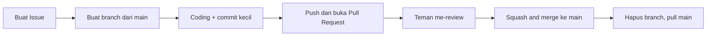

<p align="center">
  
</p>

<p align="center">
  <b>Backend REST API aplikasi pemesanan makanan kantin kampus</b><br>
  Mini Project Mobile Programming 2026 • Kelompok 5
</p>

<p align="center">
  
  
  
  
</p>

---

## Daftar Isi

1. [Tentang SantapKu](#1-tentang-santapku)
2. [Teknologi](#2-teknologi)
3. [Instalasi dengan Docker (Laravel Sail)](#3-instalasi-dengan-docker-laravel-sail)
4. [Instalasi dengan Laragon (Windows)](#4-instalasi-dengan-laragon-windows)
5. [Perintah yang Sering Dipakai](#5-perintah-yang-sering-dipakai)
6. [Langkah Pertama Pengembangan](#6-langkah-pertama-pengembangan)
7. [Workflow Kerja Bersama di GitHub (2 Orang)](#7-workflow-kerja-bersama-di-github-2-orang)
8. [Pembagian Tugas](#8-pembagian-tugas)
9. [Menghubungkan Flutter ke API](#9-menghubungkan-flutter-ke-api)
10. [Troubleshooting](#10-troubleshooting)
11. [Tim dan Dosen Pengampu](#11-tim-dan-dosen-pengampu)

---

## 1. Tentang SantapKu

**SantapKu** adalah aplikasi mobile untuk memesan makanan dan minuman di kantin kampus tanpa antre. Pelanggan melihat menu dan stok, memesan lewat keranjang, lalu memantau status pesanan lewat notifikasi. Admin kantin mengelola menu, stok, pesanan, dan pembayaran.

> Slogan: **Pesan dulu, santap tanpa antre**

Repositori ini berisi **backend (Laravel REST API + MySQL)**. Aplikasi mobile (Flutter) berada di repositori terpisah dan memanggil API ini.

**Peran pengguna:** `admin` dan `user`.

**12 fitur standar:** Register, Login, Logout, Dashboard, Master Data (kategori & menu), CRUD, Search, Filter, Detail Data, Transaksi (checkout), Status Transaksi, Riwayat.

**Tabel dasar database:** `users`, `categories`, `items`, `transactions`, `transaction_details`, `notifications` (lihat ERD pada dokumen perancangan).

---

## 2. Teknologi

| Bagian | Teknologi |
|---|---|
| Backend | Laravel 12 (PHP ^8.2), Laravel Sanctum untuk autentikasi token |
| Database | MySQL 8.4 |
| Frontend asset | Vite + Tailwind CSS 4 (bawaan Laravel) |
| Client mobile | Flutter (repositori terpisah) |
| Lingkungan dev | Docker (Laravel Sail) **atau** Laragon |
| Testing & format | PHPUnit, Laravel Pint |

---

## 3. Instalasi dengan Docker (Laravel Sail)

Cara ini membuat semua orang memakai versi PHP/MySQL yang sama persis.

### 3.1 Prasyarat

- **Git**
- **Docker Desktop** (macOS/Windows) atau Docker Engine + Compose (Linux)
- **Windows:** wajib aktifkan **WSL 2**, lalu jalankan semua perintah di bawah **di dalam terminal WSL (Ubuntu)** dan simpan project di filesystem WSL (mis. `~/projects/`), bukan di `C:\`. Ini jauh lebih cepat.

### 3.2 Langkah instalasi

```bash
# 1. Clone repositori
git clone https://github.com/frizennwave/SantapKu.git
cd SantapKu

# 2. Siapkan file environment
cp .env.example .env
```

Buka `.env`, lalu sesuaikan bagian database untuk Sail:

```dotenv
DB_CONNECTION=mysql
DB_HOST=mysql          # nama service di compose.yaml (BUKAN 127.0.0.1)
DB_PORT=3306
DB_DATABASE=santapku_db
DB_USERNAME=sail
DB_PASSWORD=password
```

```bash
# 3. Install dependency Composer (tanpa perlu PHP di komputer)
docker run --rm \
  -u "$(id -u):$(id -g)" \
  -v "$(pwd):/var/www/html" \
  -w /var/www/html \
  laravelsail/php84-composer:latest \
  composer install --ignore-platform-reqs

# 4. Jalankan container (pertama kali butuh waktu untuk build image)
./vendor/bin/sail up -d

# 5. Generate key, migrasi database, dan isi data awal
./vendor/bin/sail artisan key:generate
./vendor/bin/sail artisan migrate --seed

# 6. Install dan jalankan Vite (untuk asset web)
./vendor/bin/sail npm install
./vendor/bin/sail npm run dev
```

Buka **http://localhost** (atau `http://localhost:<APP_PORT>` jika diubah). Cek kesehatan aplikasi di **http://localhost/up**.

> **Tips: buat alias `sail`** supaya tidak mengetik `./vendor/bin/sail` terus-menerus:
> ```bash
> echo "alias sail='sh \$([ -f sail ] && echo sail || echo vendor/bin/sail)'" >> ~/.bashrc
> source ~/.bashrc
> ```
> Setelah itu cukup `sail up -d`, `sail artisan migrate`, dan seterusnya.

### 3.3 Mengakses database dari luar container

Gunakan DBeaver / TablePlus / HeidiSQL:

| Field | Nilai |
|---|---|
| Host | `127.0.0.1` |
| Port | `3306` (atau nilai `FORWARD_DB_PORT`) |
| User | `sail` |
| Password | `password` |
| Database | `santapku_db` |

### 3.4 Menghentikan dan mereset

```bash
sail stop        # hentikan container (data tetap ada)
sail down        # hapus container (data tetap ada di volume)
sail down -v     # hapus container + volume = DATABASE IKUT TERHAPUS
```

---

## 4. Instalasi dengan Laragon (Windows)

### 4.1 Prasyarat

- **Laragon Full** (sudah termasuk Apache/Nginx, MySQL, PHP, Composer, Node.js, dan Git) dari [laragon.org](https://laragon.org/download/)
- Pastikan **PHP ≥ 8.2**: klik kanan Laragon → *PHP* → pilih versi 8.2 atau lebih baru
- Ekstensi PHP aktif: `mbstring`, `openssl`, `pdo_mysql`, `fileinfo`, `curl`, `zip` (umumnya sudah aktif; cek via *Menu → PHP → Extensions*)

### 4.2 Langkah instalasi

1. **Start All** di Laragon (Apache + MySQL berjalan).
2. Buka **Terminal** dari Laragon (bukan CMD biasa) lalu clone ke folder `www`:

   ```bash
   cd C:\laragon\www
   git clone https://github.com/frizennwave/SantapKu.git
   cd SantapKu
   ```

3. **Buat database.** Klik *Database → HeidiSQL* (atau phpMyAdmin), lalu buat database `santapku_db` dengan collation `utf8mb4_unicode_ci`. Atau lewat terminal:

   ```bash
   mysql -u root -e "CREATE DATABASE santapku_db CHARACTER SET utf8mb4 COLLATE utf8mb4_unicode_ci;"
   ```

4. **Siapkan `.env`:**

   ```bash
   copy .env.example .env
   ```

   Pastikan bagian database seperti ini (default Laragon: user `root`, password kosong):

   ```dotenv
   DB_CONNECTION=mysql
   DB_HOST=127.0.0.1
   DB_PORT=3306
   DB_DATABASE=santapku_db
   DB_USERNAME=root
   DB_PASSWORD=
   ```

5. **Install dependency, key, dan migrasi:**

   ```bash
   composer install
   php artisan key:generate
   php artisan migrate --seed
   npm install
   ```

6. **Jalankan aplikasi.** Pilih salah satu:

   **Opsi A: Virtual host Laragon (otomatis)**
   Klik kanan Laragon → *Apache → Reload* (atau restart). Folder `SantapKu` otomatis bisa dibuka di **http://santapku.test**. Ubah `APP_URL=http://santapku.test` di `.env`.
   Untuk asset Vite jalankan di terminal lain: `npm run dev`.

   **Opsi B: Server bawaan Laravel**
   ```bash
   composer run dev
   ```
   Perintah ini menjalankan server, queue, log, dan Vite sekaligus. Buka **http://127.0.0.1:8000**.

> Jika `composer run dev` gagal karena `pail` (butuh ekstensi `pcntl`, tidak tersedia di Windows), jalankan manual dua terminal: `php artisan serve` dan `npm run dev`.

---

## 5. Perintah yang Sering Dipakai

| Tujuan | Docker (Sail) | Laragon |
|---|---|---|
| Jalankan aplikasi | `sail up -d` | `php artisan serve` |
| Migrasi | `sail artisan migrate` | `php artisan migrate` |
| Reset DB + data awal | `sail artisan migrate:fresh --seed` | `php artisan migrate:fresh --seed` |
| Buat model + migration + controller | `sail artisan make:model Item -mcr` | `php artisan make:model Item -mcr` |
| Tambah paket Composer | `sail composer require nama/paket` | `composer require nama/paket` |
| Daftar route | `sail artisan route:list` | `php artisan route:list` |
| Jalankan test | `sail artisan test` | `php artisan test` |
| Format kode | `sail bin pint` | `./vendor/bin/pint` |
| Tinker (REPL) | `sail artisan tinker` | `php artisan tinker` |
| Masuk shell container | `sail shell` | n/a |

---

## 6. Langkah Pertama Pengembangan

Project ini masih berupa kerangka Laravel dan **belum memiliki `routes/api.php`** maupun Sanctum. Lakukan **satu kali, oleh satu orang saja**, lalu push agar yang lain tinggal `pull`:

```bash
# Membuat routes/api.php, memasang Laravel Sanctum, dan migration personal_access_tokens
php artisan install:api
```

Setelah itu, urutan pengerjaan yang disarankan (mengikuti ERD):

1. **Migration 6 tabel dasar** dalam satu PR, dengan urutan yang benar karena ada Foreign Key:
   `users` (tambah kolom `phone`, `role`, `photo`) → `categories` → `items` → `transactions` → `transaction_details` → `notifications`.
2. **Seeder:** 1 akun admin, 1 akun user, beberapa kategori, dan 10–15 menu contoh (`DatabaseSeeder`).
3. **Auth API:** register, login, logout + middleware pembatas role `admin`/`user`.
4. Fitur lainnya sesuai [pembagian tugas](#8-pembagian-tugas).

**Konvensi API:** awalan `/api`, format JSON, token Sanctum pada header `Authorization: Bearer <token>`. Daftar endpoint lengkap ada pada Bab VI dokumen perancangan.

Akun contoh (isi pada seeder, **hanya untuk development**):

| Peran | Email | Password |
|---|---|---|
| Admin | `admin@santapku.test` | `password` |
| User | `user@santapku.test` | `password` |

---

## 7. Workflow Kerja Bersama di GitHub (2 Orang)

Kita memakai **GitHub Flow**: satu cabang utama `main` yang selalu dalam keadaan jalan, dan setiap pekerjaan dilakukan di **branch pendek** lalu digabung lewat **Pull Request (PR)** yang di-review teman. Untuk tim 2 orang ini paling sederhana dan minim konflik.



### 7.1 Setup awal (dilakukan sekali)

**Anggota A (pemilik repositori):**

1. Buat repositori kosong di GitHub (tanpa README/.gitignore karena sudah ada di project).
2. Pastikan `.env` dan `vendor/` **tidak** terlacak (sudah ada di `.gitignore`), lalu push project awal:

   ```bash
   git init
   git add .
   git status                      # pastikan TIDAK ada .env, vendor/, node_modules/
   git commit -m "chore: initial Laravel project"
   git branch -M main
   git remote add origin https://github.com/frizennwave/SantapKu.git
   git push -u origin main
   ```

3. Undang teman: **Settings → Collaborators → Add people** (atau buat Organization dan tambahkan sebagai member).
4. **Lindungi branch `main`:** *Settings → Branches → Add branch ruleset* (atau *branch protection rule*) untuk `main`, aktifkan:
   - ✅ **Require a pull request before merging** dengan **1 approval**
   - ✅ **Require conversation resolution before merging**
   - ✅ **Block force pushes** dan **Restrict deletions**
   - (opsional) ✅ *Do not allow bypassing the above settings* agar pemilik pun disiplin

   Dengan aturan ini tidak ada yang bisa `push` langsung ke `main`.

5. Di *Settings → General → Pull Requests*: aktifkan **Allow squash merging** (nonaktifkan merge commit dan rebase merge) dan **Automatically delete head branches**.

**Anggota B:**

```bash
git clone https://github.com/frizennwave/SantapKu.git
cd SantapKu
git config user.name  "Nama Anda"
git config user.email "email-yang-sama-dengan-github@contoh.com"
```
Lalu ikuti [instalasi](#3-instalasi-dengan-docker-laravel-sail) sampai aplikasi berjalan.

### 7.2 Papan tugas: Issues dan Project

- Satu **fitur/tugas = satu Issue** (mis. `Kelola menu & stok (CRUD)`), berisi deskripsi, daftar endpoint, dan kriteria selesai.
- **Assign** issue ke satu orang (PIC) supaya tidak ada yang mengerjakan hal yang sama.
- Buat **GitHub Project** (tab *Projects*, template *Board*) dengan kolom **Todo → In Progress → In Review → Done**.
- Label yang disarankan: `feature`, `bug`, `database`, `docs`, `blocked`, `urgent`.

### 7.3 Aturan penamaan

**Branch:** `jenis/nomor-issue-deskripsi-singkat`

```
feat/12-auth-api
feat/15-crud-menu
fix/21-stok-tidak-berkurang
docs/30-update-readme
chore/32-setup-pint
```

**Commit** mengikuti [Conventional Commits](https://www.conventionalcommits.org/) (boleh Bahasa Indonesia):

```
feat: tambah endpoint login dan logout
fix: validasi stok saat checkout
docs: tambah panduan instalasi laragon
refactor: pindahkan logika harga ke service
chore: jalankan pint
```

Tulis commit **kecil dan sering** (1 commit = 1 perubahan logis).

### 7.4 Alur kerja harian

```bash
# 1. Mulai dari main yang terbaru
git switch main
git pull origin main

# 2. Buat branch untuk tugas
git switch -c feat/15-crud-menu

# 3. Kerjakan, lalu commit berkala
git add app/Http/Controllers/ItemController.php routes/api.php
git commit -m "feat: tambah CRUD menu untuk admin"

# 4. Sebelum push/PR, bawa perubahan terbaru dari main ke branch Anda
git fetch origin
git merge origin/main            # selesaikan konflik jika ada (lihat 7.6)

# 5. Pastikan test dan format aman
php artisan test                 # Sail: sail artisan test
./vendor/bin/pint                # Sail: sail bin pint

# 6. Push dan buka Pull Request
git push -u origin feat/15-crud-menu
```

Di GitHub klik **Compare & pull request**, isi template PR, pilih teman sebagai **Reviewer**, lalu pindahkan kartu Issue ke *In Review*.

### 7.5 Review dan merge

**Reviewer** (teman Anda):

- Tarik branch dan coba langsung: `git fetch origin && git switch feat/15-crud-menu`
- Periksa: sesuai issue? ada validasi? role dibatasi? migration bisa jalan dari nol? tidak ada rahasia ter-commit?
- Beri komentar spesifik, lalu **Approve** atau **Request changes**.

**Penulis PR** memperbaiki sesuai komentar dengan commit tambahan di branch yang sama.

Setelah di-approve, penulis PR menekan **Squash and merge**. Lalu semua orang memperbarui lokal:

```bash
git switch main
git pull origin main
git branch -d feat/15-crud-menu
```

> **Target:** PR kecil (di bawah ±300 baris) dan di-review dalam 24 jam. PR besar sulit di-review dan mudah konflik.

### 7.6 Menangani konflik merge

1. Jalankan `git merge origin/main` di branch Anda. Git menandai file bermasalah.
2. Buka file tersebut, cari penanda `<<<<<<<`, `=======`, `>>>>>>>`, lalu putuskan isi akhirnya (sering kali **gabungan keduanya**). Hapus semua penanda.
3. `git add <file>` lalu `git commit` (pesan otomatis boleh dipakai).
4. Jalankan ulang test, lalu `git push`.

Jika bingung, **jangan paksa** (`push --force`). Hubungi teman dan selesaikan bersama.

### 7.7 Aturan khusus project Laravel

| Hal | Aturan |
|---|---|
| `.env` | **Jangan pernah di-commit.** Jika ada variabel baru, tambahkan ke `.env.example` dan kabari tim. |
| Migration | **Jangan edit migration yang sudah di-merge ke `main`.** Buat migration baru (`make:migration`) untuk perubahan. |
| Urutan migration | Tabel dasar dibuat **satu orang dalam satu PR** supaya urutan Foreign Key benar. Setelah itu, masing-masing menambah migration baru. |
| `composer.lock` / `package-lock.json` | Ikut di-commit. Jika konflik: ambil versi `main`, jalankan `composer install` / `npm install`, lalu commit hasilnya. |
| `routes/api.php` | File bersama yang rawan konflik: tambahkan route per fitur di **blok/group terpisah**, dan merge `main` sering-sering. |
| Seeder | Data contoh lewat seeder, **bukan** dengan membagikan file dump `.sql`. Cukup jalankan `migrate:fresh --seed`. |
| Upload gambar | Folder `storage/app/public` tidak di-commit. Jalankan `php artisan storage:link` di lokal masing-masing. |
| Formatter | Jalankan Pint sebelum commit agar gaya kode seragam dan diff bersih. |

### 7.8 Definition of Done (sebuah tugas dianggap selesai bila)

- [ ] Fitur sesuai kriteria pada Issue
- [ ] Validasi input dan pembatasan role sudah ada
- [ ] `migrate:fresh --seed` berjalan tanpa error
- [ ] Test (minimal 1 feature test per endpoint utama) lolos
- [ ] PR sudah di-review dan di-merge ke `main`
- [ ] Endpoint dicatat (README / koleksi Postman) agar tim Flutter bisa memakainya

### 7.9 Etika kerja berdua

- **Sync singkat** 2–3 kali seminggu (10–15 menit): apa yang selesai, apa yang menghambat.
- Selalu **komunikasikan perubahan di file bersama** (route, seeder, model `User`) sebelum mengerjakannya.
- **Saling me-review** secara bergantian agar keduanya paham seluruh kode (ingat: setiap anggota harus memahami keseluruhan rancangan saat presentasi).
- Siapa pun yang selesai lebih dulu membantu teman, bukan menumpuk PR.

---

## 8. Pembagian Tugas

> Ganti `Anggota A` / `Anggota B` dengan nama masing-masing. Contoh ini membagi beban rata dan meminimalkan ketergantungan.

| Tahap | Tugas | PIC | Catatan |
|---|---|---|---|
| 0 | `install:api`, migration 6 tabel, seeder awal | Anggota A | Selesaikan dulu, B menunggu |
| 1 | Auth (register, login, logout), middleware role | Anggota A | Dipakai semua fitur lain |
| 1 | Daftar menu publik: list, **search**, **filter**, detail | Anggota B | Butuh tabel `items` dan seeder dari tahap 0 |
| 2 | Kelola kategori dan menu & stok (CRUD, upload gambar) | Anggota A | Khusus admin |
| 2 | Checkout: buat transaksi + detail, validasi stok | Anggota B | Dalam database transaction |
| 3 | Terima/tolak pesanan, ubah status, verifikasi pembayaran, pengurangan stok | Anggota A | Aturan AB-02 s.d. AB-05 pada dokumen |
| 3 | Notifikasi, riwayat pesanan, batalkan pesanan, unggah bukti bayar | Anggota B | Notifikasi dibuat dari event perubahan status |
| 4 | Dashboard (user & admin), profil | Bergantian | |
| 5 | Pengujian bersama, perbaikan bug, dokumentasi, latihan presentasi | Berdua | |

---

## 9. Menghubungkan Flutter ke API

| Perangkat | Base URL |
|---|---|
| Android Emulator → Sail (port 80) | `http://10.0.2.2/api` |
| Android Emulator → `php artisan serve` | `http://10.0.2.2:8000/api` |
| iOS Simulator | `http://localhost/api` |
| HP fisik (satu Wi-Fi) | `http://<IP-LAN-komputer>/api` |

Untuk HP fisik dengan `php artisan serve`, jalankan `php artisan serve --host=0.0.0.0` dan izinkan port tersebut di firewall. Android 9+ memblokir HTTP polos secara default; untuk development tambahkan `android:usesCleartextTraffic="true"` pada `AndroidManifest.xml`.

---

## 10. Troubleshooting

| Masalah | Solusi |
|---|---|
| `port is already allocated` (port 80) | Hentikan Laragon/Apache lain, atau tambahkan `APP_PORT=8080` di `.env` |
| `port 3306 already in use` | Tambahkan `FORWARD_DB_PORT=3307` di `.env`, lalu `sail up -d` |
| Sail: `SQLSTATE[HY000] [2002] Connection refused` | `DB_HOST` harus `mysql` (bukan `127.0.0.1`); tunggu MySQL *healthy* beberapa detik |
| Sail: `Access denied for user 'sail'` setelah mengganti password | Volume lama masih memakai password lama: `sail down -v` lalu `sail up -d` (**data hilang**) |
| Laragon: `Access denied for user 'root'` | Pastikan `DB_PASSWORD=` kosong dan `DB_HOST=127.0.0.1` |
| `No application encryption key has been specified` | Jalankan `php artisan key:generate` |
| `Vite manifest not found` | Jalankan `npm run dev` (atau `npm run build`) |
| Perubahan `.env` tidak terbaca | `php artisan config:clear` |
| `The "pail" command requires pcntl` (Windows) | Abaikan `composer run dev`; jalankan `php artisan serve` dan `npm run dev` terpisah |
| Docker lambat di Windows | Pindahkan project ke filesystem WSL 2, bukan `/mnt/c/...` |
| Terlanjur meng-commit `.env` | `git rm --cached .env`, commit, lalu **ganti `APP_KEY`** dan password yang bocor |

---

## 11. Tim dan Dosen Pengampu

| Nama | NIM | Peran |
|---|---|---|
| Mohamad Rifki Hanifudin | 2495114009 | Backend / Database |
| Muhammad Tanzil Zakaria | 2495114037 | Backend / Flutter |

**Dosen pengampu:** Edwin Hari Agus Prastyo, S.Kom., M.Kom.

---

<p align="center"><sub>SantapKu • Pesan dulu, santap tanpa antre</sub></p>
